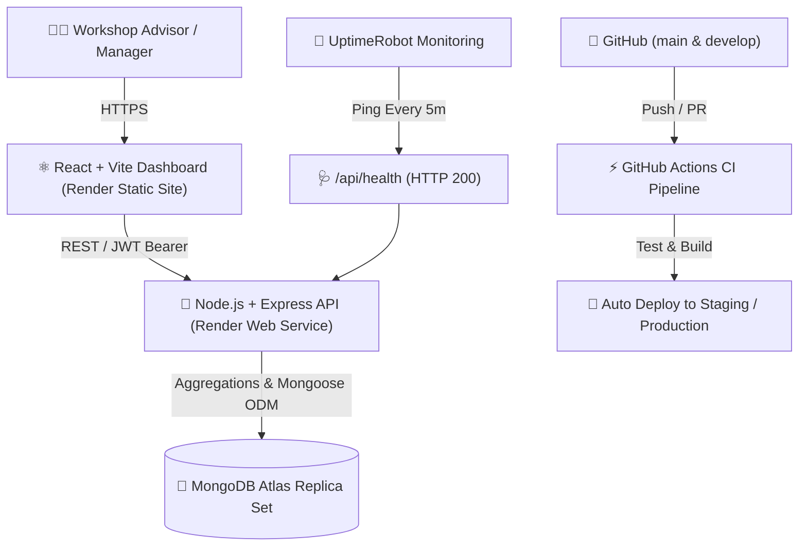

# 🚗 Automotivemedium – Multi-Brand Car Service Centre Management System

[](https://github.com/vekar/automotivemedium/actions/workflows/ci.yml)
[](https://nodejs.org/)
[](https://www.mongodb.com/atlas)
[](https://render.com)
[](LICENSE)

**Automotivemedium** is a full-stack enterprise MERN application engineered for multi-brand automotive workshop operations. It provides end-to-end management for vehicle intake, digital job cards, customer relationship tracking, spare parts inventory control, and multi-location workshop bay scheduling.

The system features **100% database-side MongoDB aggregation pipelines** (`Model.aggregate()`) for real-time executive analytics, complete GitHub Actions CI automation, and dual-tier staging and production deployments on Render.

---

## 📌 Key Capabilities & Architecture



### 1. Multi-Brand Vehicle Management
Supports major manufacturers including **Maruti Suzuki, Hyundai, Tata Motors, Mahindra, Toyota, and Honda**. Tracks registration numbers, chassis numbers, fuel types (Petrol, Diesel, EV, CNG, Hybrid), and odometer mileage.

### 2. Multi-Centre Workshop Operations
Manages branch facilities across **Mumbai, Pune, Ahmedabad, Bengaluru, and Delhi NCR**. Tracks active bay capacities, mechanics availability, and live bay utilization.

### 3. Workflow Progression & Digital Job Cards
Tracks live repairs through defined stages:
`Booked` ➔ `Inspection` ➔ `In Progress` ➔ `Parts Replacement` ➔ `Ready` ➔ `Completed`

### 4. Spare Parts Inventory & Low Stock Triggers
Automated inventory stock tracking with reorder alerts when quantity falls below threshold, calculating real-time inventory cost valuation and retail value.

### 5. High-Performance MongoDB Aggregations
All 6 executive reports run directly inside MongoDB using native aggregation stages (`$lookup`, `$unwind`, `$group`, `$project`, `$facet`, `$sort`). **Zero in-memory array filtering.**

---

## 🏗️ Technology Stack

| Layer | Technologies Used |
|---|---|
| **Frontend** | React 18, Vite 6, Chart.js, React-ChartJS-2, Lucide Icons, Axios, CSS Variables |
| **Backend** | Node.js (v20/v26), Express.js 4, Mongoose 8, JWT, BcryptJS, Helmet, Morgan, Cors |
| **Database** | MongoDB Atlas (Cloud Replica Set), Multi-field Compound Indexes |
| **Testing** | Jest, Supertest, Cross-Env |
| **DevOps / CI** | GitHub Actions (`.github/workflows/ci.yml`), Render Infrastructure as Code (`render.yaml`) |
| **Monitoring** | UptimeRobot, `/api/health` JSON probe |

---

## 📂 Project Directory Structure

```
Automotivemedium/
├── .github/
│   └── workflows/
│       └── ci.yml               # GitHub Actions CI Workflow
├── backend/                     # Node.js + Express API
│   ├── src/
│   │   ├── config/              # Database & Env Configuration
│   │   ├── controllers/         # Business Logic & Aggregations
│   │   ├── middleware/          # Auth, Roles & Error Handlers
│   │   ├── models/              # 8 Mongoose Schemas & Indexes
│   │   ├── routes/              # Express REST Endpoints
│   │   ├── seeds/               # Multi-brand Seed Generator
│   │   └── server.js            # Express App & Server Bootstrap
│   ├── tests/                   # Jest & Supertest Automated Tests
│   ├── .env.example             # Backend Env Template
│   └── package.json
├── frontend/                    # React 18 + Vite SPA
│   ├── src/
│   │   ├── components/          # Sidebar, Navbar, StatCard, Charts
│   │   ├── context/             # AuthContext & State Management
│   │   ├── pages/               # 12 Core Management Pages (Lazy Loaded)
│   │   ├── services/            # Axios HTTP Client with Interceptors
│   │   ├── App.jsx              # Suspense & Code Splitting Routing
│   │   └── index.css            # Responsive Design System
│   ├── index.html
│   ├── vite.config.js           # Rollup Manual Chunk Optimization
│   ├── .env.example             # Frontend Env Template
│   └── package.json
├── render.yaml                  # Render Blueprint Specification
├── package.json                 # Monorepo Scripts
└── README.md
```

---

## 🚀 Getting Started (Local Setup)

### Prerequisites
- Node.js (v18, v20, or v22+)
- npm (v9+)
- Git installed
- MongoDB Atlas cluster or local MongoDB instance

### 1. Clone the Repository
```bash
git clone https://github.com/vekar/automotivemedium.git
cd automotivemedium
```

### 2. Configure Environment Variables

**Backend (`backend/.env`):**
```env
PORT=5000
NODE_ENV=development
MONGODB_URI=mongodb+srv://<username>:<password>@cluster0.example.mongodb.net/automotivemedium_dev?retryWrites=true&w=majority
JWT_SECRET=super_secret_automotivemedium_jwt_token_key_2026_dev
JWT_EXPIRE=7d
CORS_ORIGIN=http://localhost:5173,http://localhost:3000
```

**Frontend (`frontend/.env`):**
```env
VITE_API_URL=/api
```

### 3. Install Dependencies
```bash
# Install backend dependencies
npm --prefix backend install

# Install frontend dependencies
npm --prefix frontend install
```

### 4. Seed Database with Realistic Multi-Brand Data
```bash
node backend/src/seeds/seedData.js
```

### 5. Start Servers
```bash
# In Terminal 1 - Start Backend API (Port 5000)
npm --prefix backend run dev

# In Terminal 2 - Start Frontend Client (Port 5173)
npm --prefix frontend run dev
```

Open [http://localhost:5173](http://localhost:5173) in your browser.

**Default Admin Credentials:**
- Email: `admin@automotivemedium.com`
- Password: `Admin@123`

---

## 🧪 Automated Testing

Automated testing is configured using Jest and Supertest.

```bash
# Run backend unit and health check tests
npm --prefix backend test
```

Sample passing test output:
```
PASS tests/health.test.js
  Health Check API Endpoint
    √ GET /api/health should respond with json and service information (413 ms)
    √ GET / should return welcome payload and documentation links (33 ms)
    √ GET /api/unknown-route should return 404 with standard error format (45 ms)

Test Suites: 1 passed, 1 total
Tests:       3 passed, 3 total
```

---

## 📊 MongoDB Aggregation Pipelines

All executive reports are powered by native `Model.aggregate()` pipelines:

| Endpoint | Pipeline Stages Used | Purpose |
|---|---|---|
| `GET /api/reports/bookings-by-brand` | `$lookup ➔ $unwind ➔ $lookup ➔ $group ➔ $project ➔ $sort` | Bookings, revenue, and average ticket size grouped by car brand |
| `GET /api/reports/monthly-revenue` | `$match ➔ $group ➔ $project ➔ $sort` | Monthly gross revenue, labour vs parts income stream |
| `GET /api/reports/most-serviced-models` | `$lookup ➔ $unwind ➔ $lookup ➔ $group ➔ $sort ➔ $limit(10)` | Top 10 most frequently serviced car models |
| `GET /api/reports/inventory-valuation` | `$facet ➔ $group ➔ $project ➔ $match` | Multi-faceted parallel valuation of stock, purchase cost, retail value, and low-stock count |
| `GET /api/reports/service-centres` | `$lookup ➔ $unwind ➔ $group ➔ $project ➔ $sort` | Bay occupancy, active workflows, and utilization rate by workshop location |
| `GET /api/reports/status-distribution` | `$group ➔ $project ➔ $sort` | Real-time service status breakdown across all bays |

---

## 🌐 Staging & Production Deployment (Render)

Deployments are managed via the root `render.yaml` specification:

- **Production Environment (`main` branch):**
  - Frontend: `https://automotivemedium-web-prod.onrender.com`
  - Backend: `https://automotivemedium-api-prod.onrender.com`
  - Database: `automotivemedium_prod`
- **Staging Environment (`develop` branch):**
  - Frontend: `https://automotivemedium-web-staging.onrender.com`
  - Backend: `https://automotivemedium-api-staging.onrender.com`
  - Database: `automotivemedium_staging`

---

## 🩺 Uptime Monitoring (UptimeRobot)

1. Open [UptimeRobot](https://uptimerobot.com).
2. Click **Add New Monitor**.
3. Select **Monitor Type: HTTP(s)**.
4. Set **URL:** `https://automotivemedium-api-prod.onrender.com/api/health`.
5. Set **Monitoring Interval:** 5 minutes.
6. Set **Keyword Monitoring:** Look for `"status":"healthy"`.
7. Configure Email / Slack notifications for alert triggers.

---

## 📄 License
This project is licensed under the ISC License.
